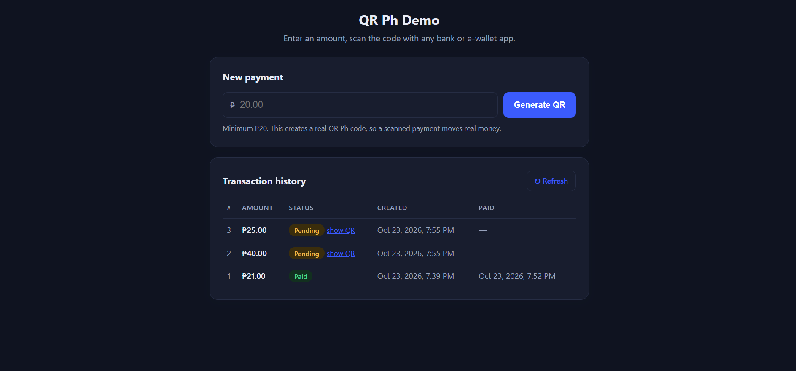
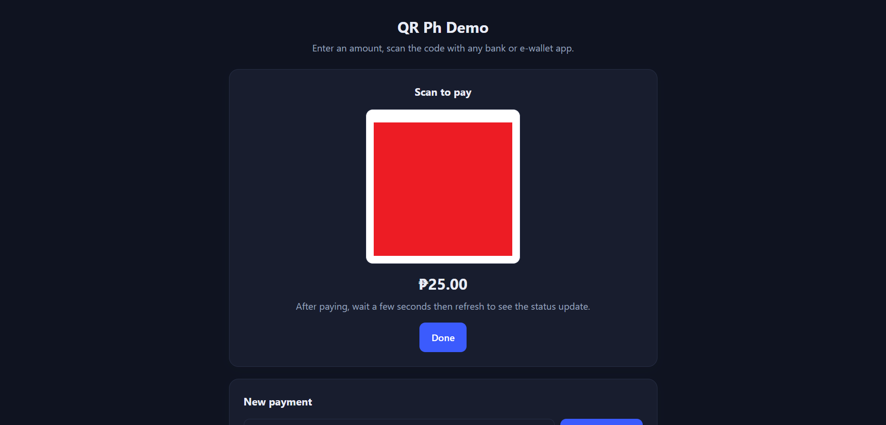

# Express.js Serverless Paymongo QR Ph Demo
Scan to pay any bill.

## Previews



## Setup
1. Create an `.env` file that contains:
    ```env
    PAYMONGO_SECRET_KEY=sk_...
    WEBHOOK_SECRET=whsk_...
    DATABASE_URL=postgresql://[USERNAME]:[PASSWORD]@[HOST]:[PORT]/[DATABASE_NAME]
    ```
2. Run `npm install`
3. Run `npm run dev` then go to `http://localhost:3000` to view your project.

## WEBHOOK
- For a webhook to work, the project must be publicly rechable in the internet.
- Use the `https://[YOUR-PUBLIC-DOMAIN]/webhook` in Paymongo webhook url.